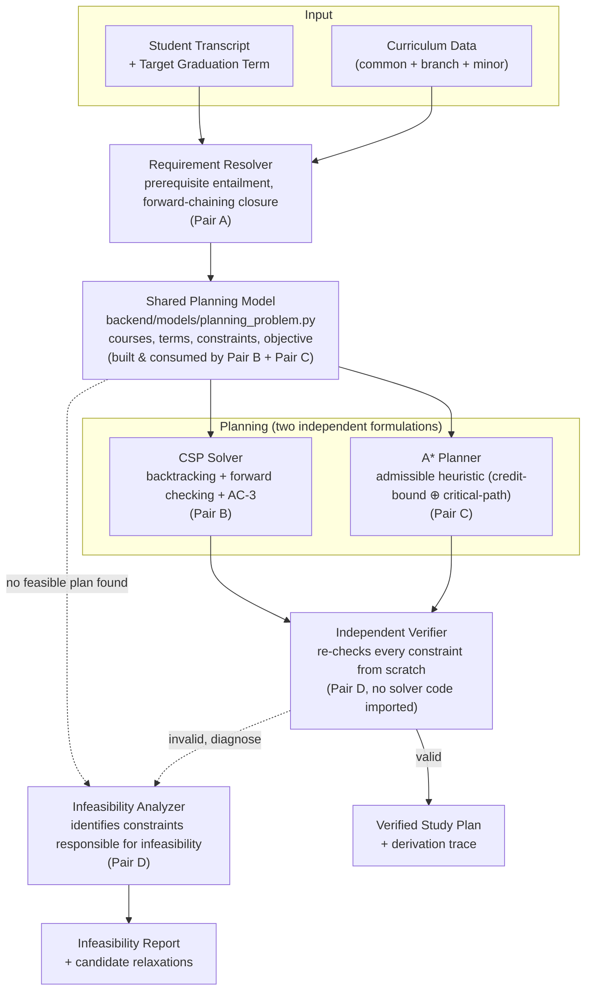

# LogicForge
# GraphMind
### A Constraint-Aware Degree Plan Generator

**Team:** LogicForge · **Course:** CS F407/U407 — Artificial Intelligence, Sem I 2026–27 · **Institution:** BITS Pilani, Hyderabad Campus
**Topic Areas:** Search & Problem Solving + Knowledge Representation & Reasoning · **Track:** Application

---

## 1. Overview

GraphMind takes a student's completed coursework and generates a feasible, semester-by-semester plan to graduation — satisfying prerequisite chains, corequisites, per-semester credit limits, odd/even term offerings, degree-requirement categories, and minor requirements simultaneously.

The problem is formulated and solved two ways:
- as a **Constraint Satisfaction Problem** (backtracking, extended with forward checking and AC‑3), and
- as an **informed search problem** (A* over a shared planning model).

The two formulations are compared on the same instances. When no valid plan exists, GraphMind identifies the constraints responsible for the infeasibility and reports possible relaxations, rather than returning nothing.

> Full problem statement, course-concept mapping, and the submitted evaluation plan live in [`docs/proposal.pdf`](./docs/proposal.pdf) — read that before touching code. Scope, algorithms, and experiments here are expected to match that proposal; if something here would diverge from it, flag it in PR review rather than quietly changing scope.

## 2. Features

- **Dual-formulation planning** — CSP backtracking (FC + AC‑3 + MRV/degree + LCV) and A* search run against the same constraint model, so results are directly comparable.
- **A\* admissible heuristic** — a lower bound on remaining terms, derived from remaining required credits and per-term credit capacity (`⌈remaining_credits / max_credits_per_term⌉`), plus a critical-path bound from the longest remaining prerequisite chain. This bounds the search; it is **not** a prediction of a student's actual graduation date, and is only as accurate as the admissibility proof holds for the final cost formulation.
- **Propositional prerequisite logic** — prerequisites expressed as Boolean formulas (`CS F211 AND (MATH F211 OR MATH F213)`), evaluated by entailment against completed coursework.
- **Independent verification** — every generated plan is re-checked by a verifier implemented separately from both solvers, by a team member who wrote neither.
- **Infeasibility diagnosis** — when no plan exists, GraphMind identifies the constraints responsible for the infeasibility via deletion-based conflict extraction. This explains *which* constraints are in conflict; it does not currently guarantee the conflict set returned is of minimum size, and the README/report will not claim minimality unless that property is implemented and tested.
- **Branch-aware curriculum data** — common courses, branch-specific requirements, and minor requirements are kept as separate data, so branches can be added or validated independently (see [`docs/data_schema.md`](./docs/data_schema.md)).

## 3. Architecture



Both solvers consume the **same** planning model — that's what makes the CSP-vs-A* comparison (Experiment E1) meaningful. The verifier is written independently of both solvers and re-checks every constraint from scratch; it does not trust either solver's own claim of correctness.

Full module-by-module responsibilities, the planning-model schema, and the integration contract between pairs are in [`docs/architecture.md`](./docs/architecture.md).

## 4. Team

| # | Name | ID No. | Pair |
|---|------|--------|------|
| 1 | Pratham Singla | 2024A8PS0486H | A |
| 2 | Krishna Gupta | 2024A3PS0380H | A |
| 3 | Aditya Sanadhaya | 2024AAPS0263H | B |
| 4 | Kshitij Mathur | 2024A8PS0462H | B |
| 5 | Jenil Karia | 2024A7PS0100H | C |
| 6 | Raj Parab | 2024A3PS0433H | C |
| 7 | Mohammad Mubeen Mazar Khan | 2024A8PS0489H | D |
| 8 | Vedant Shah | 2024A7PS0135H | D |

### Pair ownership (4 pairs, each owns a component end to end)

| Pair | Members | Owns |
|---|---|---|
| **A** | Krishna Gupta, Pratham Singla | Curriculum KB & validation; prerequisite formulas, entailment evaluator, forward-chaining closure |
| **B** | Aditya Sanadhaya, Kshitij Mathur | CSP formulation; backtracking + forward checking + AC‑3 + MRV/LCV; Experiment E2 |
| **C** | Raj Parab, Jenil Karia | A* planner, admissible heuristics, learned heuristic; Experiments E1, E3 |
| **D** | Mubeen Khan, Vedant Shah | Independent plan verifier; infeasibility analyser; benchmarking & stats; integration/interface |

Pair A is on the critical path and starts immediately (Week 1 toy curriculum unblocks B/C/D to work in parallel). **Pair D must never implement a solver** — their verifier has to stay independent of both the CSP and A* code so it can genuinely catch their bugs.

Branching, PR rules, and commit conventions are in [`docs/contributing.md`](./docs/contributing.md) — read that before your first PR.

## 5. Setup

```bash
git clone https://github.com/VedantLiteCoder0135/LogicForge.git
cd LogicForge
python -m venv venv && source venv/bin/activate   # or your preferred env manager
pip install -r requirements.txt
```

Launch the app:

```bash
streamlit run frontend/app.py
```

That's it — the Streamlit app calls `backend/services/planning_service.py` directly in-process, so there's no separate API server to run for local development. Runtime defaults (curriculum directory, per-term credit cap, etc.) live in `config/settings.py`; there is currently no `.env` file because nothing in the app reads one — if that changes (e.g. a deployed API is added later), this section and `docs/architecture.md` get updated together.

## 6. Current Status

Dates below are from the submitted proposal. Status is **not** auto-updated — each pair updates their own row in the same PR that meets the criterion, and nothing is marked done until the criterion is actually met.

### Weekly milestones

| Week | Dates | Milestone | Completion criteria |
|---|---|---|---|
| 1 | 3–9 Oct | KB schema, loader, validation suite; toy curriculum | 10-course toy curriculum loads via `backend/data/loader.py`; validation suite runs and reports zero cycles/undefined course codes on the toy data |
| 2 | 10–16 Oct | Prerequisite formulas + entailment evaluator; fixpoint closure | Entailment evaluator correctly resolves a hand-written Boolean prerequisite against a completed-course set; forward-chaining closure terminates and is idempotent on toy data |
| 3 | 17–23 Oct | Real curriculum encoded & cross-checked; planning model constructed | At least one real branch's course list + requirements loads and passes validation; `backend/models/planning_problem.py` builds a model object from it |
| 4 | 24–30 Oct | Backtracking solver producing valid plans; independent verifier | CSP solver returns a plan for at least one real toy/sample student profile; verifier independently confirms it against the same model with no shared code path |
| 5 | 31 Oct–6 Nov | End-to-end system | A transcript run through the Streamlit app produces a verified plan, start to finish, for at least one real curriculum branch |
| 6 | 7–13 Nov | Forward checking, AC‑3, MRV/LCV; propagation ablation (E2) | Each propagation technique can be toggled independently; E2 produces a backtrack-count/runtime comparison across the configurations defined in `docs/experiments.md` |
| 7 | 14–20 Nov | A* + admissible heuristics; infeasibility analyser; solver comparison (E1) | A* returns a plan on the same instances as the CSP solver; E1 reports validity/optimality/time/nodes for both; infeasibility analyser returns a non-empty, re-checkable set of conflicting constraints on at least one deliberately infeasible instance |
| 8 | 21–24 Nov | Learned heuristic integration; feature-complete | Learned heuristic loads and produces a value on real states; full feature set from §2 runs without a code path that raises on the sample transcripts |
| 9 | 25–27 Nov | Benchmarks, user evaluation (E5), explanation interface, bug fixing | Benchmark suite (`docs/experiments.md`) run completes on all ~200 synthetic states and produces results under `experiments/results/`; at least the target number of volunteer users (6–10, per proposal) have run E5 |
| 10 | 28–30 Nov | Final demo, report, submission | `docs/report/` compiled; live demo runs end to end without manual patching |

Week 5 is intended to be a complete, if narrow, working system — everything after that extends something that already runs end to end, not a system still being assembled for the first time.

### Component status

| Component | Owner | Completion criteria | Status |
|---|---|---|---|
| Curriculum loader + validation suite | Pair A | Loads real branch data; flags cycles/undefined codes/unreachable courses | ⬜ Not yet started |
| Prerequisite entailment + forward chaining | Pair A | Resolves Boolean prerequisite formulas against a completed-course set; closure is idempotent | ⬜ Not yet started |
| Shared planning model (`backend/models/`) | Pair B + Pair C | Builds from real curriculum data; used unmodified by both solvers | ⬜ Not yet started |
| CSP solver (backtracking + FC + AC‑3 + ordering) | Pair B | Returns a valid plan on sample transcripts; propagation techniques independently toggleable for E2 | ⬜ Not yet started |
| A* planner + heuristics | Pair C | Returns a plan on the same instances as the CSP solver; heuristic admissibility holds on test cases | ⬜ Not yet started |
| Learned heuristic | Pair C | Trained on self-supervised data; evaluated against hand-crafted heuristics in E3 | ⬜ Not yet started |
| Independent verifier | Pair D | Re-checks every constraint from a plan + model with no imports from `csp/` or `astar/` | ⬜ Not yet started |
| Infeasibility analyzer | Pair D | Returns a non-empty, re-checkable conflicting-constraint set on a known-infeasible instance | ⬜ Not yet started |
| Streamlit frontend | Pair D | Transcript in → verified plan or infeasibility report out, via `planning_service.py` | ⬜ Not yet started |
| Benchmark + experiments E1–E5 | Pair D (+ owning pair per experiment, see `docs/experiments.md`) | Each experiment runs and produces the output defined in `docs/experiments.md` | ⬜ Not yet started |

## 7. Documentation

| Doc | Covers |
|---|---|
| [`docs/proposal.pdf`](./docs/proposal.pdf) | Submitted proposal — problem statement, course concepts, methodology, evaluation plan, references |
| [`docs/architecture.md`](./docs/architecture.md) | Full repository layout, module responsibilities, planning-model schema, integration contracts |
| [`docs/data_schema.md`](./docs/data_schema.md) | Curriculum data format — common vs. branch vs. minor data, validation status per branch |
| [`docs/contributing.md`](./docs/contributing.md) | Branching strategy, PR rules, commit conventions |
| [`docs/experiments.md`](./docs/experiments.md) | E1–E5 defined explicitly, aligned with the submitted proposal |
| [`docs/ai_usage.md`](./docs/ai_usage.md) | Running AI-tool-usage disclosure log (course requirement) |
| [`docs/report/`](./docs/report/) | Final written report (owned by Pair D — every pair writes and owns their own section; see `docs/contributing.md`) |