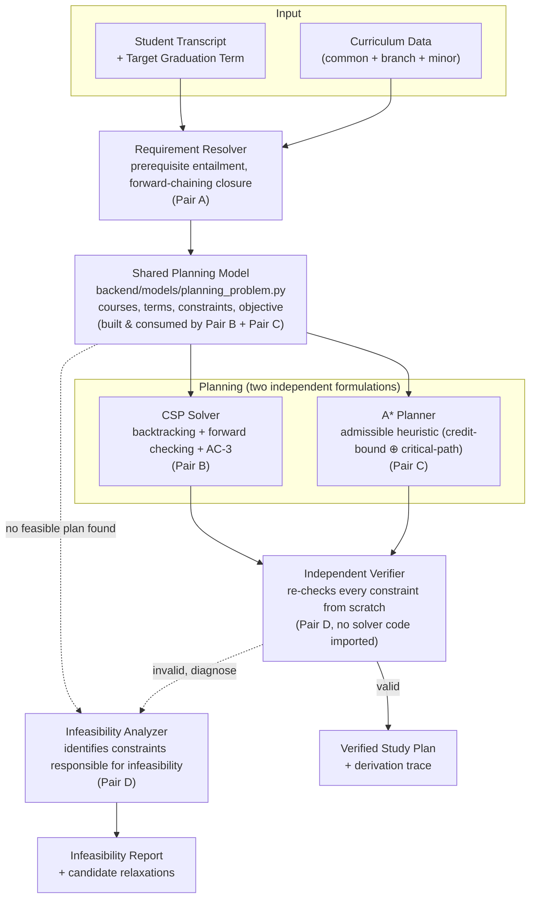

# Architecture

This document describes the intended module layout and data flow for GraphMind. It reflects the design in `docs/proposal.pdf`; it is a design reference, not a claim that every module below is implemented — check §6 (Current Status) in the root `README.md` for what's actually built.

## 1. End-to-end flow



**Why the shared model matters:** the CSP solver and the A* planner both read from the exact same `PlanningProblem` object built by the Requirement Resolver. Neither solver gets its own copy of the constraint logic. This is what makes Experiment E1 (solver comparison) a fair comparison rather than two differently-scoped systems being compared.

**Why the verifier is separate:** `backend/verification/plan_checker.py` is written by Pair D, who implement neither solver, and it imports nothing from `backend/csp/` or `backend/astar/`. It re-derives plan validity from the transcript, curriculum data, and the proposed plan directly — it does not trust either solver's internal state.

## 2. Repository layout

```
LogicForge/
│
├── README.md
├── requirements.txt
├── .gitignore
│
├── config/
│   └── settings.py                # curriculum dir, per-term credit cap, solver defaults — plain Python constants
│
├── data/
│   ├── curriculum/
│   │   ├── common/
│   │   │   └── courses.json               # courses taken by students across all branches (HSS, labs, etc.)
│   │   ├── branches/
│   │   │   ├── cse/
│   │   │   │   ├── courses.json
│   │   │   │   └── requirements.json      # branch-specific categories + credit minimums
│   │   │   ├── ece/
│   │   │   │   ├── courses.json
│   │   │   │   └── requirements.json
│   │   │   └── e_and_i/
│   │   │       ├── courses.json
│   │   │       └── requirements.json
│   │   ├── minors/
│   │   │   └── <minor_name>/
│   │   │       ├── courses.json
│   │   │       └── requirements.json
│   │   ├── branches.json                  # registry: which branch/minor dirs exist
│   │   └── VALIDATION_STATUS.md           # which branches/minors have passed the validation suite — see docs/data_schema.md
│   │
│   └── samples/
│       ├── sample_transcript.json
│       └── sample_plan.json
│
├── backend/
│   ├── __init__.py
│   │
│   ├── models/                     # Pair B + Pair C jointly own this — shared by both solvers
│   │   ├── __init__.py
│   │   ├── course.py               # Course: code, title, credits, term_parity, category, prerequisite formula
│   │   ├── curriculum.py           # Curriculum: aggregates common + branch + minor course/requirement data
│   │   ├── study_plan.py           # StudyPlan: term -> [course_code], plus any metadata a plan carries
│   │   └── planning_problem.py     # PlanningProblem: the shared constraint/search model both solvers consume
│   │
│   ├── data/                       # Pair A
│   │   ├── __init__.py
│   │   ├── loader.py                # loads common/branch/minor JSON into Curriculum objects
│   │   └── validator.py             # cycle/undefined-code/unreachable-course/category-floor checks
│   │
│   ├── logic/                      # Pair A
│   │   ├── __init__.py
│   │   ├── prerequisite_parser.py   # parses prerequisite strings into propositional formulas
│   │   ├── prerequisite_checker.py  # entailment against a completed-course set
│   │   └── forward_chaining.py      # fixpoint requirement-closure rules
│   │
│   ├── csp/                        # Pair B
│   │   ├── __init__.py
│   │   ├── backtracking.py
│   │   ├── forward_checking.py
│   │   ├── ac3.py
│   │   └── variable_ordering.py     # MRV + degree heuristic, LCV
│   │
│   ├── astar/                      # Pair C
│   │   ├── __init__.py
│   │   ├── planner.py
│   │   └── heuristics.py            # credit-bound, critical-path, composite (max of admissible bounds)
│   │
│   ├── ml/                         # Pair C
│   │   ├── __init__.py
│   │   ├── generate_training_data.py   # runs the optimal planner over synthetic states to produce labels
│   │   ├── train_model.py
│   │   └── predict.py
│   │
│   ├── verification/                # Pair D — no imports from csp/ or astar/
│   │   ├── __init__.py
│   │   └── plan_checker.py
│   │
│   ├── explanations/                # Pair D
│   │   ├── __init__.py
│   │   ├── plan_explainer.py        # derivation trace for a valid plan
│   │   └── infeasibility_analyzer.py # deletion-based conflicting-constraint extraction
│   │
│   └── services/                    # Pair D owns the file; B and C each expose one entry point here
│       ├── __init__.py
│       └── planning_service.py      # solve_csp(model), solve_astar(model), verify(plan, model) — called directly by frontend/
│
├── frontend/                        # Streamlit app — Pair D (+ any pair visualizing their own output)
│   ├── app.py
│   ├── pages/
│   │   ├── 1_Student_Profile.py
│   │   ├── 2_Study_Plan.py
│   │   └── 3_Why_Not_Feasible.py
│   └── components/
│       ├── course_selector.py
│       └── plan_visualizer.py
│
├── tests/                           # every pair writes tests for their own module
│   ├── test_data_validation.py      # Pair A
│   ├── test_prerequisites.py        # Pair A
│   ├── test_csp.py                  # Pair B
│   ├── test_astar.py                # Pair C
│   ├── test_plan_checker.py         # Pair D
│   └── test_integration.py          # Pair D
│
├── experiments/                     # E1–E5 — see docs/experiments.md for what each one measures
│   ├── csp_ablation.py              # Pair B — E2
│   ├── heuristic_comparison.py      # Pair C — E3
│   └── results/                     # plots, CSVs, confidence intervals — Pair D collates for E4/E5
│
└── docs/
    ├── proposal.pdf
    ├── architecture.md              # this file
    ├── data_schema.md
    ├── contributing.md
    ├── experiments.md
    ├── ai_usage.md
    └── report/                      # final written report (Pair D compiles, see docs/contributing.md)
```

There is currently **no `backend/api/` directory and no separate API server.** The Streamlit frontend calls `backend/services/planning_service.py` directly, in-process. If a standalone API later becomes genuinely necessary (e.g. a non-Streamlit client needs to call GraphMind), add it deliberately and update this document and the root README together — don't let API scaffolding accumulate without a consumer.

## 3. Shared planning model (`backend/models/`)

All four model files below are owned jointly by Pair B and Pair C, since both the CSP solver and the A* planner build and read from them. Changes need review from both pairs.

- **`course.py` — `Course`**: one course's static data — code, title, credits, which terms it's offered in (odd/even/both), its requirement category, and its prerequisite formula (as produced by `backend/logic/prerequisite_parser.py`).
- **`curriculum.py` — `Curriculum`**: the resolved set of courses and requirement categories for one branch (+ optional minor), after `backend/data/loader.py` has merged common + branch-specific + minor data.
- **`study_plan.py` — `StudyPlan`**: a candidate or final assignment of outstanding courses to terms — the object both solvers produce and the verifier consumes.
- **`planning_problem.py` — `PlanningProblem`**: the actual CSP/search model — variables (outstanding courses), domains (remaining terms + null for optional courses), and the constraint set (prerequisite ordering, corequisite coupling, per-term credit windows, category credit minimums, graduation horizon). This is the object the CSP solver and A* planner both consume unmodified.

This replaces an earlier draft where the shared model lived under `backend/csp/problem_model.py` — it's been moved to `backend/models/planning_problem.py` since it is not CSP-specific and A* depends on it equally.

## 4. A* heuristic — what it actually guarantees

The A* heuristic used here is a **lower bound on the number of remaining terms**, not an estimate of real-world graduation timing. Two admissible components are combined:

1. **Credit bound**: `⌈remaining_credits / max_credits_per_term⌉` — admissible because no term can supply more credits than the ceiling.
2. **Critical-path bound**: the depth of the longest remaining prerequisite chain — admissible because a chain of depth *k* needs at least *k* terms under the ordering constraint.

If both components are admissible under the final state/cost formulation used, their pointwise maximum is also admissible and dominates either bound individually. This guarantees A* will not overestimate the true remaining cost under that formulation — it does **not** mean the number returned predicts how long a specific student will actually take to graduate in every case; real students have constraints (course availability in practice, personal pacing, failed attempts) this bound does not model.

## 5. Infeasibility analysis — what it actually guarantees

`backend/explanations/infeasibility_analyzer.py` uses deletion-based conflict extraction (Junker, 2004) to return the set of constraints responsible for an instance being infeasible. This tells the user *which* constraints are in conflict and lets them see candidate relaxations.

It does **not** currently guarantee the returned conflict set is of minimum size. If/when a minimality guarantee is implemented and verified (e.g. against brute-force on small instances, per the proposal's E4), update this section and the corresponding README line together — until then, neither document should claim minimality.
